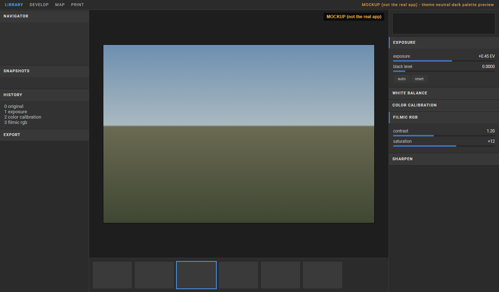

# Theme: neutral-dark

File: `darktable-fork/data/themes/neutral-dark.css` (GPL-3.0 header kept). It imports `darktable.css` and `chunk-fonts.css` (Roboto family, same as the elegant themes), overrides named colors, then adds a few flat widget rules.

The screenshot is a **MOCKUP (not the real app)**: an HTML page that uses the theme palette. darktable is not installed here and the app has not been built yet.

## Design decisions
- Neutral greys only (no color cast around the photo); panels #2b2b2b, deep center #1e1e1e.
- One restrained accent, muted blue (#4a9eff text/active marker, #3a78c2 slider fills and selections).
- Flat: no gradients or shadows on buttons, entries, sliders; 1px #3d3d3d separators, 3px radii.
- Module headers: small bold letter-spaced caps, extra padding; active modules get a 2px accent bar on the left.
- Thin scrollbars (6px), generous padding in headers and labels.

## Palette
| Role | Color |
|---|---|
| Center / darkroom / lighttable bg, graphs | #1e1e1e |
| Side panels, filmstrip | #2b2b2b |
| Module body | #323232 |
| Module header, buttons | #383838 |
| Hover | #444444 |
| Border | #3d3d3d |
| Text / heading text / dim text | #b8b8b8 / #d6d6d6 / #7d7d7d |
| Accent / accent dim | #4a9eff / #3a78c2 |

## Switching theme
- Preferences > general (or first-run welcome screen) theme list: "neutral dark", grey, dark, darker.
- Config key `ui_last/theme` (e.g. `neutral-dark`, `darktable-elegant-grey`). Default is `neutral-dark`; missing theme files fall back to it (src/gui/gtk.c).
- Users can drop their own `.css` in `~/.config/darktable/themes/`.

## Validation done
Python check: braces balanced (17/17), every `@name` used is defined (in theme, darktable.css or chunk-fonts.css), only GTK 3.24-supported properties used. Not tested inside a real GTK build.

## Spots referencing theme names
- `data/darktableconfig.xml.in` (default + welcomescreen options): done.
- `src/gui/gtk.c` fallback: done.
- `data/themes/darktable-icons-*.css` import the elegant themes; no `darktable-icons-neutral-dark` variant exists (icon-colored variant). Add one if wanted: `@import darktable-icons.css` then `darktable-elegant`-style neutral-dark.
- Theme CSS files are installed by a glob in data/CMakeLists.txt.
